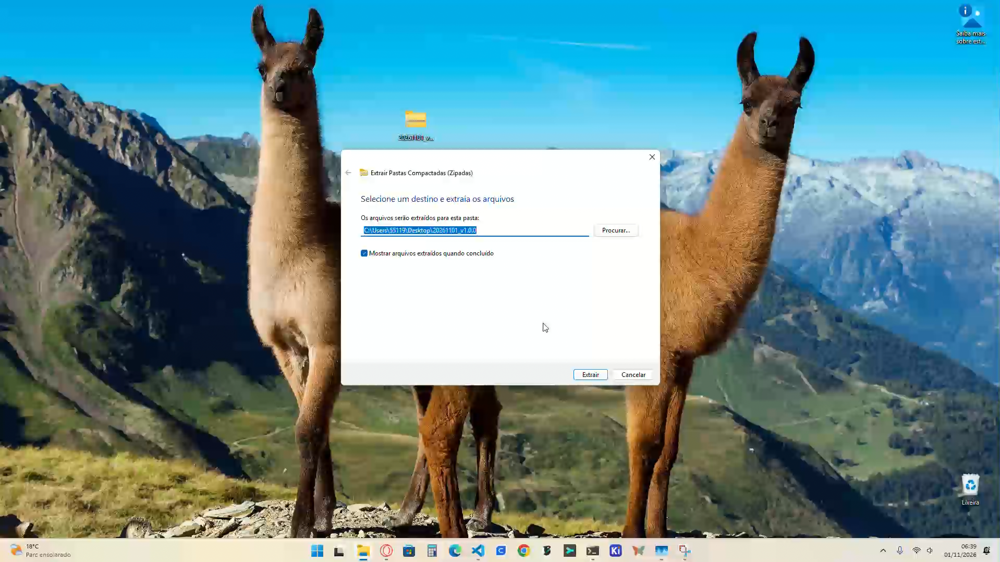

# 📡 ISDB-T / ISDB-Tb Universal SDR Receiver & Real-Time Player

<p align="center">
  
  
  
  
  
  
</p>

Receptor e decodificador digital completo de televisão aberta no padrão **ISDB-T / ISDB-Tb / SBTVD** (Brasil, Japão, Filipinas e América Latina) para dispositivos **RTL-SDR** (RTL2832U com tuners R820T/R828D/E4000). Desenvolvido em **C++ nativo de alta performance sem dependências do framework GNU Radio**, com equalização adaptativa **MMSE**, ponderação **CSI** no decodificador Viterbi, varredura inteligente de canais com identificação de nomes via **SDT** e **reprodutor MPV embutido com super-resolução e interpolação de movimento em tempo real**.

---

<p align="center">
  <b>Idioma / Language:</b><br/>
  <b>🇧🇷 Português (Brasil)</b> &nbsp;|&nbsp; 
  <a href="README_en.md">🇺🇸 English</a>
</p>

---

## 🎬 Demonstração em Tempo Real

Assista ao decodificador em execução ao vivo sintonizando a emissora aberta (*BAND HD*, Canal 23 UHF), demodulando o sinal de RF a 2.0317 MSps e reproduzindo o fluxo no player MPV integrado com interpolação de escala e movimento ativados:

<div align="center">
  <video src="docs/videos/demo.mp4" poster="docs/videos/demo_poster.png" controls width="90%" style="border-radius: 8px; box-shadow: 0 4px 16px rgba(0,0,0,0.35);">
    <a href="docs/videos/demo.mp4">
      
    </a>
    <p><em>Clique na imagem acima ou <a href="docs/videos/demo.mp4">acesse diretamente docs/videos/demo.mp4</a> para assistir ao vídeo em resolução original.</em></p>
  </video>
</div>

---

## 📑 Índice (Sumário)

- [⚡ 1. Guia Rápido para Usuários Finais (Download & Execução)](#-1-guia-rápido-para-usuários-finais-download--execução)
  - [1.1 Download da Release Autônoma](#11-download-da-release-autônoma)
  - [1.2 Instalação do Driver USB (Zadig em 1 Clique)](#12-instalação-do-driver-usb-zadig-em-1-clique)
  - [1.3 Comandos Essenciais da CLI](#13-comandos-essenciais-da-cli)
  - [1.4 Recursos e Teclas do Player MPV Integrado](#14-recursos-e-teclas-do-player-mpv-integrado)
- [🛠️ 2. Guia para Desenvolvedores (Compilação & Testes)](#️-2-guia-para-desenvolvedores-compilação--testes)
  - [2.1 Pré-requisitos & Dependências](#21-pré-requisitos--dependências)
  - [2.2 Como Compilar Nativamente](#22-como-compilar-nativamente)
  - [2.3 Suíte de Testes Determinísticos (CTest)](#23-suíte-de-testes-determinísticos-ctest)
  - [2.4 Automação de Releases (`build_release.ps1`)](#24-automação-de-releases-build_releaseps1)
  - [2.5 Mapa da Arquitetura do Código](#25-mapa-da-arquitetura-do-código)
- [🔬 3. Camada Física (DSP) & Inovações Matemáticas](#-3-camada-física-dsp--inovações-matemáticas)
  - [3.1 Resumo dos Algoritmos de Camada Física](#31-resumo-dos-algoritmos-de-camada-física)
  - [3.2 Documentação Técnica Especializada](#32-documentação-técnica-especializada)
- [🤝 4. Projetos de Referência & Agradecimentos](#-4-projetos-de-referência--agradecimentos)
- [📜 5. Licença](#-5-licença)

---

## ⚡ 1. Guia Rápido para Usuários Finais (Download & Execução)

Se você deseja apenas sintonizar e assistir à TV Digital no seu computador com o RTL-SDR, siga os passos abaixo:

### 1.1 Download da Release Autônoma
Baixe o arquivo `.zip` da versão estável mais recente na pasta de lançamentos:
- 📦 **Windows x64:** [`releases/windows/20261101_v1.0.0.zip`](file:///c:/Users/55119/Projects/isdb_t_isdb_tb_tuner_player/releases/windows/20261101_v1.0.0.zip) *(ou na aba [Releases do GitHub](../../releases))*
- Descompacte o arquivo `.zip` em qualquer pasta do seu computador. Todos os componentes (executável, bibliotecas DLL, utilitário Zadig e player MPV com shaders) já estão inclusos.

### 1.2 Instalação do Driver USB (Zadig em 1 Clique)
Para que o decodificador converse diretamente com o chip RTL2832U:
1. Conecte o dongle RTL-SDR e a antena UHF a uma porta USB do computador.
2. Dê um duplo clique no arquivo **`zadig.exe`** (incluso na pasta descompactada).
3. No menu **Options**, clique em **List All Devices**.
4. No menu suspenso, selecione **`Bulk-In, Interface (Interface 0)`** *(ou `RTL2832U` / `RTL2838UHIDIR`)*.
   > ⚠️ **Atenção:** Se houver `Interface 0` e `Interface 1`, selecione **sempre a `Interface 0`** (o barramento de alta velocidade do sinal de RF).
5. Certifique-se de que o driver alvo à direita da seta seja **`WinUSB`** e clique em **`Install Driver`** (ou `Replace Driver`).

### 1.3 Comandos Essenciais da CLI
Abra o PowerShell ou Prompt de Comando (CMD) na pasta descompactada:

```powershell
# 1. Inspecionar se o dongle RTL-SDR foi reconhecido e exibir ganhos:
.\isdbtb_rx.exe probe

# 2. Varrer os canais do ar na faixa UHF (canais 14 a 69):
#    (A varredura inteligente em dois passos identifica o nome oficial da emissora via SDT)
.\isdbtb_rx.exe scan

# 3. Listar a grade de canais salvos:
.\isdbtb_rx.exe list

# 4. Sintonizar um canal (ex: Canal 23) e abrir automaticamente o player MPV integrado:
.\isdbtb_rx.exe play -c 23 --player
```

> 💡 **Encerramento Sincronizado:** O player MPV é gerenciado por um *Job Object* do kernel do Windows. Ao fechar o terminal da CLI ou pressionar `Ctrl+C`, o player fecha instantaneamente sem deixar processos órfãos em segundo plano.

### 1.4 Recursos e Teclas do Player MPV Integrado
O reprodutor MPV embutido inclui um pipeline gráfico pré-configurado (`tools/mpv/mpv.conf`) especialmente desenhado para transmissões móveis 1-Seg:
- **Super-Resolução Espacial:** Filtro `ewa_lanczossharp` com `sigmoid-upscaling`, gerando bordas limpas e sem dentes de serra ao ampliar para 1080p/4K.
- **Debanding Dinâmico:** Elimina artefatos de compressão e blocos de cor típicos do vídeo H.264 em baixa taxa de bits.
- **Interpolação de Movimento (`display-resample`):** Sincroniza a taxa do vídeo com a frequência de atualização do seu monitor (60Hz, 120Hz, 144Hz ou 240Hz), eliminando qualquer engasgo (*judder*).

| Tecla de Atalho | Ação no Player MPV |
|:---:|---|
| **`f`** | Alternar modo **Tela Cheia** (*Fullscreen*) |
| **`i`** | Exibir painel OSD com estatísticas em tempo real, resolução e taxa de quadros |
| **`d`** | Ativar / Desativar o filtro de Deband |
| **`m`** | Ativar / Desativar mudo (*Mute*) |
| **`9` / `0`** | Diminuir / Aumentar volume |
| **`q`** | Fechar o player |

---

## 🛠️ 2. Guia para Desenvolvedores (Compilação & Testes)

### 2.1 Pré-requisitos & Dependências
- **Compilador C++17:** GCC 11+ (MinGW-w64 no Windows, GCC/Clang no Linux).
- **Sistema de Compilação:** CMake 3.20+.
- **Bibliotecas de Aceleração e Rádio:**
  - `librtlsdr` e `libusb-1.0` (cabeçalhos e bibliotecas inclusos em `deps/`).
  - `FFTW3` (transformadas rápidas de Fourier de 2048, 4096 e 8192 pontos).
  - `VOLK` (operações matemáticas vetoriais com suporte a AVX2, FMA e SSE).
- *(Opcional para testes e scripting):* Python 3.8+ e PowerShell 7+.

### 2.2 Como Compilar Nativamente
No terminal do Windows com ambiente MinGW-w64 (ex: `w64devkit`):

```powershell
# 1. Configurar o projeto com CMake em modo Release
cmake -S . -B build -G "MinGW Makefiles" -DCMAKE_BUILD_TYPE=Release

# 2. Compilar o executável principal e a suíte de testes unitários
cmake --build build -j
```

### 2.3 Suíte de Testes Determinísticos (CTest)
O projeto conta com testes unitários matemáticos que rodam em frações de segundo e não dependem de rádio físico conectado:

```powershell
# Executar todos os testes via CTest com saída detalhada em caso de falha:
ctest --test-dir build --output-on-failure
```

Os testes cobrem:
1. `test_reed_solomon`: Correção de até 8 erros por pacote e detecção de falha via Berlekamp-Massey e Forney.
2. `test_descrambler`: LFSR de dispersão de energia de 15 bits do ISDB-T com avanço sobre o sync byte `0x47`.
3. `test_viterbi`: Decodificador convolucional $K=7$ contínuo com puncionamento (taxas 1/2, 2/3, 3/4, 5/6, 7/8).
4. `test_fec_pipeline`: Cadeia completa de FEC integrada (Viterbi $\to$ Byte Deinterleaver $\to$ Descrambler $\to$ Reed-Solomon).
5. `test_ofdm_sync`: Estimador ML de Van de Beek para sincronismo de símbolo OFDM e rastreamento de FFO.
6. `test_oneseg_e2e`: Pipeline fim-a-fim simulado com modulação QPSK, taxa 2/3, GI 1/8 e desentrelaçamento temporal $I=4$.

### 2.4 Automação de Releases (`build_release.ps1`)
O repositório fornece um script em PowerShell para geração e verificação automática de pacotes de release:

```powershell
# Gera a release completa do Windows (compila, testa, empacota e valida):
.\scripts\build_release.ps1 -Platform windows

# Pular compilação caso o binário já esteja pronto:
.\scripts\build_release.ps1 -Platform windows -SkipBuild
```

O script empacota os binários, DLLs, utilitário Zadig, MPV e licença em `releases/<plataforma>/yyyymmdd_v<versao>.zip` e **valida automaticamente** a integridade e os tamanhos de todos os arquivos internos via API nativa `.NET ZipFile`, garantindo 100% de compatibilidade com o Windows Explorer.

### 2.5 Mapa da Arquitetura do Código

```text
isdb_t_isdb_tb_tuner_player/
├── CMakeLists.txt              # Script de configuração do CMake
├── LICENSE                     # GNU General Public License v3.0 (GPLv3)
├── README.md                   # Documentação principal
├── AGENTS.md                   # Invariantes arquiteturais rígidas para IA e desenvolvedores
├── include/
│   ├── dsp/                    # Algoritmos de Camada Física (OfdmSync, OneSegDemod, Viterbi, RS, etc.)
│   ├── streaming/              # UdpStreamer (transmissão de 1316 bytes para MPV/VLC)
│   ├── mpegts/                 # Parser de tabelas PSI/SI (PAT, PMT, SDT) e gerador TS
│   ├── cli/                    # ChannelManager e persistência JSON
│   └── third_party/            # CLI11, nlohmann/json
├── src/
│   ├── main.cpp                # Ponto de entrada CLI, captura assíncrona USB e Job Object do MPV
│   └── ...                     # Implementações C++ dos módulos de DSP, MPEG-TS e streaming
├── tools/
│   ├── zadig.exe               # Utilitário oficial de instalação de drivers USB
│   └── mpv/                    # Reprodutor MPV portátil com shaders de interpolação em tempo real
├── scripts/
│   ├── build_release.ps1       # Automação de build, empacotamento e validação de releases
│   ├── play_mpv.bat            # Script auxiliar de disparo manual do player MPV
│   └── calibrate_ppm.py        # Utilitário de calibração de oscilador local
├── releases/                   # Pacotes de release prontos para uso (windows/, linux/, macos/)
├── docs/                       # Documentação técnica detalhada e decisões arquiteturais (ADR)
└── tests/                      # Casos de teste determinísticos (CTest)
```

---

## 🔬 3. Camada Física (DSP) & Inovações Matemáticas

### 3.1 Resumo dos Algoritmos de Camada Física
- **Taxa de Amostragem Fundamental ($2031746\text{ S/s}$):** Submúltiplo exato de $1/4$ da taxa de chip $F_{base} = 512/63\text{ MHz} \approx 8.126984\text{ MHz}$, garantindo correlação de prefixo cíclico superior a $90\%$ e FFT alinhada sem necessidade de reamostragem fracionária.
- **Sincronismo de Símbolo OFDM & FFO (Van de Beek ML):** Autocorrelação de prefixo cíclico deslizante com compensação contínua de fase NCO acelerada por SIMD VOLK.
- **Equalização MMSE Regularizada:** Substituição do Zero-Forcing clássico por MMSE adaptativo ($\sigma^2 = \max(10^{-5}, 0.05 \cdot P_{\text{avg}})$), evitando explosão de ruído em nulos profundos de canais seletivos em frequência.
- **Ponderação CSI (Channel State Information) no Viterbi:** Fator de confiabilidade $W_l = \text{clamp}(|H_l|^2 / P_{\text{avg}}, 0, 2)$ atenuando métricas de subportadoras degradadas em direção ao erasure (128), proporcionando ganho de sensibilidade de **+2 a 3 dB** sob desvanecimento Rayleigh.
- **Decodificador TMCC DBPSK + BCH(273, 191):** Rastreamento de sincronismo de quadro (204 símbolos) nas portadoras 101, 131, 286 e 349, configurando modulação e desentrelaçador temporal de forma dinâmica.
- **Desentrelaçadores ISDB-T:** Frequência (`FREQ_PERM_MODE3` de 384 portadoras), Tempo convolucional ($I \times (95 - (5c \bmod 96))$), Bits e Forney ($I=12, M=17$).
- **Outer FEC Reed-Solomon:** Decodificador $RS(204, 188, t=8)$ com Berlekamp-Massey, Chien Search e Forney com $FCR=0$.

### 3.2 Documentação Técnica Especializada
Para consultar aprofundamentos matemáticos, histórico de evolução e guias avançados, consulte os documentos na pasta [`docs/`](docs/):

| Documento | Conteúdo e Finalidade |
|---|---|
| 🏛️ [`docs/ARCHITECTURE_DECISIONS.md`](docs/ARCHITECTURE_DECISIONS.md) | **Registros de Decisões de Arquitetura (ADR 001 a 017):** Histórico completo de todos os algoritmos utilizados e substituídos (Zero-Forcing $\to$ MMSE, CSI Weighting, Two-Pass Scan, MPV Job Object, alinhamento MTU 1316B, correções contra `gr-isdbt`) e suas justificativas matemáticas. |
| 📖 [`docs/USER_GUIDE.md`](docs/USER_GUIDE.md) | **Manual Detalhado do Usuário:** Instruções passo a passo de configuração, comandos avançados, sintonia fina de ganho de RF e seção de solução de problemas. |
| 📐 [`docs/blueprint_isdbt_decoder.md`](docs/blueprint_isdbt_decoder.md) | **Especificação Técnica do ISDB-T:** Parâmetros das normas ABNT NBR 15601 / 15603 e ARIB STD-B31, tabelas de entrelaçamento e taxas de transmissão. |
| 🤖 [`AGENTS.md`](AGENTS.md) | **Guia de Orientação para Agentes de IA e Engenheiros:** Regras críticas de integridade ("Não Quebre"), lista de erros históricos a não repetir e diretivas de conformidade. |

---

## 🤝 4. Projetos de Referência & Agradecimentos

Este projeto foi construído apoiando-se no trabalho e nas especificações de excelentes projetos de código aberto:

- **[`git-artes/gr-isdbt`](https://github.com/git-artes/gr-isdbt):** Implementação acadêmica de referência do padrão ISDB-T para GNU Radio desenvolvida por Federico Larroca e Martin Gomez (Universidad de la República, Uruguai). Os polinômios de entrelaçamento, PRBS e matrizes de trellis serviram de base para nosso núcleo nativo C++.
- **[`librtlsdr`](https://github.com/steve-m/librtlsdr):** Driver de código aberto para receptores baseados no Realtek RTL2832U, mantido por Steve Markgraf e Dimitri Stolnikov.
- **[`MPV Player`](https://github.com/mpv-player/mpv):** Reprodutor de mídia leve e altamente customizável que alimenta o subsistema de vídeo integrado com shaders de upscaling.
- **[`Zadig / libwdi`](https://github.com/pbatard/libwdi):** Ferramenta essencial desenvolvida por Pete Batard para instalação limpa de drivers WinUSB no Windows.
- **[`VOLK`](https://github.com/gnuradio/volk) & [`FFTW3`](https://www.fftw.org/):** Bibliotecas de cálculo vetorial de ponto flutuante e transformadas rápidas de Fourier de altíssimo desempenho.
- **[`CLI11`](https://github.com/CLIUtils/CLI11) & [`nlohmann/json`](https://github.com/nlohmann/json):** Utilitários modernos em C++ para interfaces de linha de comando e serialização de dados.

---

## 📜 5. Licença

Este projeto é um software livre distribuído sob os termos da **GNU General Public License v3.0 (GPL-3.0-or-later)**.  
Consulte o arquivo [`LICENSE`](LICENSE) para obter o texto integral da licença.
