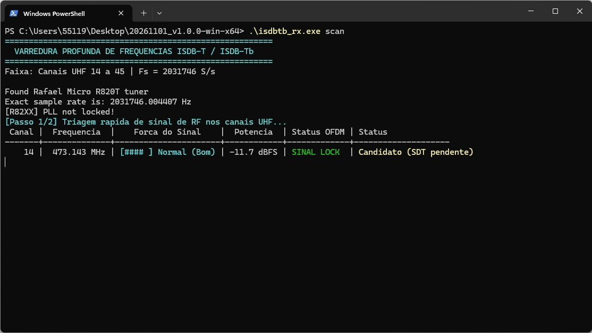
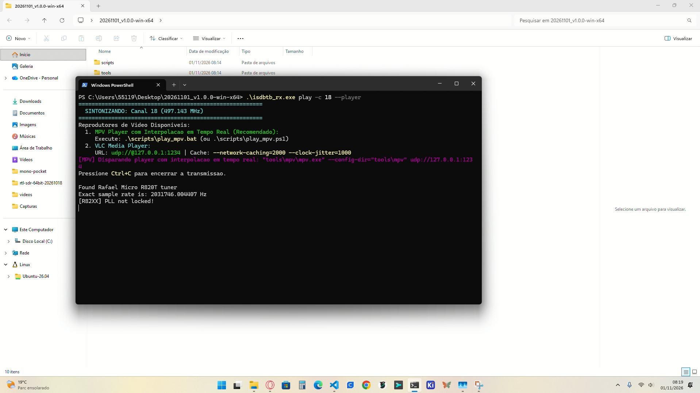
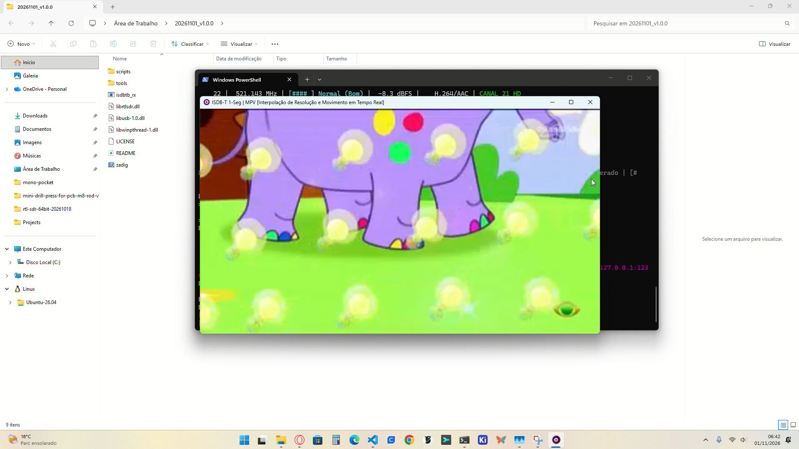
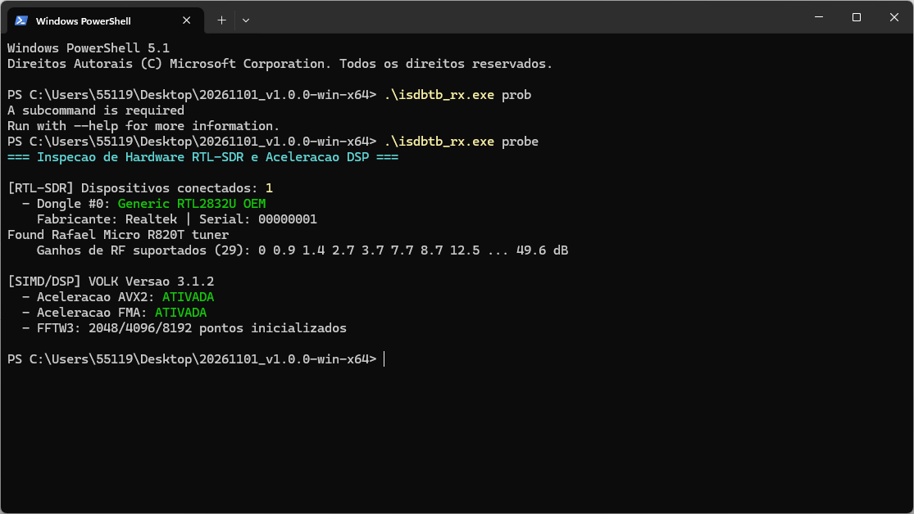

# ISDB-T / ISDB-Tb Tuner Player

<p align="center">
  
  
  
  
</p>

<p align="center"><a href="README.md">🇧🇷 Português</a> | <b>🇺🇸 English</b></p>

Watch free-to-air digital TV (ISDB-T / ISDB-Tb / SBTVD, **1-Seg** signal) on your computer with a cheap **RTL-SDR** USB dongle. Portable app: download, unzip and run; the MPV player is included.

## 1. Download
Get the latest `.zip` from the **[Releases](https://github.com/lucasbrigida/isdb_t_isdb_tb_tuner_player/releases)** tab:

| File | For |
|---|---|
| `*_win64.zip` | 64-bit Windows (most PCs) |
| `*_win32.zip` | 32-bit Windows (older PCs) |

Everything is inside: `isdbtb_rx.exe`, RTL-SDR DLLs, `zadig.exe` (USB driver) and the MPV player in `tools\mpv\`. Nothing to install.

## 2. Requirements
- RTL-SDR dongle (RTL2832U with R820T, R828D or E4000 tuner).
- UHF antenna (ideally near a window or outdoors).
- Windows 10 (1607+) or 11. The bundled MPV does not run on Windows 7/8.

## 3. First run
1. **Install the driver (first time only):** plug in the dongle, open `zadig.exe` → **Options → List All Devices** → pick **`Bulk-In, Interface (Interface 0)`** (or `RTL2838UHIDIR`) → driver **WinUSB** → **Install/Replace Driver**.
   > ⚠ If both Interface 0 and Interface 1 show up, always use **Interface 0**.
2. **Find channels:** open PowerShell in the unzipped folder and run:
   ```powershell
   .\isdbtb_rx.exe scan
   ```
3. **Watch:**
   ```powershell
   .\isdbtb_rx.exe play -c 23 --player
   ```
   Replace `23` with a channel found by `scan` (check with `list`).

## 4. Commands
| Command | What it does |
|---|---|
| `probe` | Checks that the dongle is detected |
| `scan` | Finds stations and saves them, with their names, to `channels.json` |
| `list` | Shows saved channels and signal strength |
| `play` | Tunes a channel and opens the video |
| `epg` | Shows the stations' program guide |

```powershell
.\isdbtb_rx.exe probe                          # is the dongle working?
.\isdbtb_rx.exe scan                           # find channels (UHF 14 to 45)
.\isdbtb_rx.exe scan -e 69                     # scan up to channel 69
.\isdbtb_rx.exe list                           # show saved channels
.\isdbtb_rx.exe play -c 23 --player            # watch channel 23
.\isdbtb_rx.exe play -n GLOBO --player         # watch by name
.\isdbtb_rx.exe play -c 23 --ofdm 2 --player   # weak or noisy signal
.\isdbtb_rx.exe play -c 23 --player -v         # show signal quality
.\isdbtb_rx.exe epg                            # guide for all channels
.\isdbtb_rx.exe epg --view                     # saved guide, no radio needed
```

Main `play` options:

| Option | Effect |
|---|---|
| `-c <n>` / `-n <name>` | Channel by number or name (neither: first saved channel) |
| `--player` | Opens the built-in MPV |
| `--ofdm 2` | Robust mode for weak signal, reflections or motion (more CPU) |
| `-g <dB>` | Tuner gain (default 28; far from tower 38–49.6; near 20) |
| `-v` | Shows RSSI, SNR and received packets live |
| `-p <port>` | UDP port (default 1234) |

All options: [CLI Reference](docs/user/cli_reference.md) (Portuguese).

## 5. Keys
| Where | Key | Action |
|---|---|---|
| Terminal (`play`) | `▲`/`▼`, `Enter` | Pick and tune another saved channel |
| Terminal | `q` or `Ctrl+C` | Quit (MPV closes too) |
| MPV | `f` | Fullscreen |
| MPV | `i` | Video stats |
| MPV | `m` / `9` / `0` | Mute / volume − / volume + |
| MPV | `b` | Toggle deband filter |

Prefer VLC? Run `play` without `--player` and open **Media → Open Network Stream** → `udp://@127.0.0.1:1234`.

## 6. Troubleshooting
| Symptom | Fix |
|---|---|
| `probe` can't find the dongle | Redo Zadig (Interface 0 + WinUSB); use a rear USB port, no hub |
| `scan` finds nothing | Antenna near a window; try `scan -e 69`; check your city's channels |
| Black or frozen picture | Wait for `TMCC: LOCK` (1–2 s); try `--ofdm 2` or tune `-g` |
| `[R82XX] PLL not locked!` | Plug the dongle straight into the motherboard; check the antenna cable |

More: [User Guide](docs/USER_GUIDE.md) (Portuguese).

## 7. Demo
| `scan` | `play` |
|:---:|:---:|
| <br>Scan with station names | <br>Live channel in built-in MPV |
| **demo** | **`probe`** |
| <br>Continuous reception and playback | <br>Dongle diagnostics |

## 8. For developers
Native C++17 decoder, no GNU Radio and no external DSP libraries (built-in FFT and SIMD exposing the FFTW3/VOLK APIs). It has two OFDM synchronizers (Van de Beek and SP-CIR), MMSE equalization, CSI-weighted Viterbi, Reed-Solomon with an O(1) GF(2^8) table, a lock-free SPSC capture queue and zero allocation in the DSP loop. Builds for x64 and x86.

- [Build, tests and release](docs/user/installation.md)
- [Documentation index](docs/INDEX.md): DSP, code map, tests
- [Architecture decisions (ADRs)](docs/adr/README.md)
- [AI agent rules](AGENTS.md)

## Credits
[gr-isdbt](https://github.com/git-artes/gr-isdbt) (ISDB-T reference), [librtlsdr](https://github.com/steve-m/librtlsdr), [MPV](https://github.com/mpv-player/mpv), [Zadig/libwdi](https://github.com/pbatard/libwdi), [VOLK](https://github.com/gnuradio/volk), [FFTW3](https://www.fftw.org/), [CLI11](https://github.com/CLIUtils/CLI11), [nlohmann/json](https://github.com/nlohmann/json).

## License
[GPL-3.0-or-later](LICENSE). Third-party components keep their own licenses.
