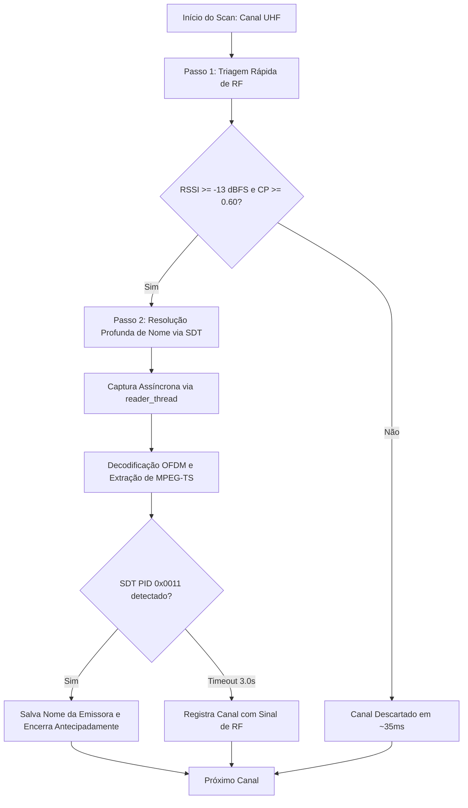

# 🏛️ Registros de Decisões de Arquitetura (ADR)

Este documento registra as decisões de engenharia fundamentais tomadas durante o design do decodificador ISDB-T/ISDB-Tb, suas alternativas avaliadas, justificativas matemáticas e de implementação.

---

## ADR 001: Escopo de Recepção Estrito em 1-Seg com Dongles RTL-SDR

### Contexto
O padrão ISDB-T/ISDB-Tb divide a banda de 6 MHz do canal de TV em 13 segmentos ortogonais:
- **Segmentos 1 a 12:** Transmissão Full-Seg de alta definição (HDTV 1080i), ocupando aproximadamente 5.2 MHz a 5.6 MHz de largura útil.
- **Segmento 0 (Central):** Transmissão One-Seg (1-Seg) para recepção móvel, ocupando \(428.57\text{ kHz}\).

O dongle RTL-SDR (baseado no chip Realtek RTL2832U) transfere amostras I/Q de 8 bits via USB 2.0. A taxa máxima de amostragem contínua segura sem descarte de amostras (dropped samples / buffer overflows) é de aproximadamente **2.4 MSps**. Taxas acima disso (como 2.8 a 3.2 MSps) provocam perda esporádica de pacotes de dados no barramento USB.

### Decisão
O escopo principal deste decodificador é **estritamente o modo 1-Seg**.

### Consequências
- **Positivas:** Estabilidade total de fluxo contínuo no RTL-SDR sem dropped samples; carga de processamento de CPU muito menor (viável em laptops e mini-PCs); compatível com qualquer dongle RTL-SDR de baixo custo.
- **Limitações:** O áudio e vídeo recebidos são os do feed 1-Seg (QVGA/VGA em H.264 e áudio AAC).
- **Variações Futuras:** Caso se deseje decodificar o feed Full-Seg (13 segmentos), a arquitetura pode ser estendida para suportar hardware SDR de banda larga (como HackRF One, Airspy R2, LimeSDR ou BladeRF) operando a \(F_s = 8.126984\text{ MSps}\).

---

## ADR 002: Taxa de Amostragem Exata (\(2031746\text{ S/s}\)) vs \(2.048\text{ MSps}\)

### Contexto
Pelas normas ARIB STD-B31 e ABNT NBR 15601, a taxa de chip fundamental do ISDB-T é:
\[
F_{base} = \frac{512}{63}\text{ MHz} \approx 8.126984\text{ MHz}
\]
A maioria dos tutoriais genéricos de SDR utiliza \(2.048\text{ MSps}\). No entanto, \(2.048\text{ MHz}\) possui um erro de frequência de amostragem de:
\[
\frac{2.048 - 2.031746}{2.031746} \approx +0.80\%
\]
Esse erro de 0.8% faz com que a janela do símbolo OFDM deslize a cada poucos símbolos, exigindo um reamostrador racional fracionário computacionalmente pesado e degradando a correlação de prefixo cíclico.

### Decisão
Configurar o hardware do RTL-SDR para operar na taxa exata:
\[
F_s = \frac{F_{base}}{4} = \frac{512}{63 \times 4}\text{ MHz} = 2031746\text{ Hz}
\]

### Consequências
- O sintonizador do RTL-SDR possui sintetizador de frequência fracionário interno que atinge \(2031746.004\text{ Hz}\) (erro inferior a 0.005 Hz).
- No Modo 3 (8K), um símbolo completo dura exatamente \(2048 + 128 = 2176\) amostras (para GI 1/16).
- A correlação do prefixo cíclico saltou de \(11.5\%\) para **\(94.5\%\)** de pico nos testes reais, garantindo sincronismo de símbolo robusto e estável.

---

## ADR 003: Streaming UDP (\(7 \times 188 = 1316\text{ bytes}\)) para o Reprodutor VLC

### Contexto
Para exibir o canal sintonizado ao usuário, foram analisadas três abordagens:
1. **Pipe binário no terminal (`| vlc -`):** No Windows, o PowerShell e o CMD possuem problemas frequentes com quebra de pipes binários ao fechar o player, além de exigir comandos longos.
2. **Servidor HTTP integrado (HLS):** Exige fatiar arquivos `.ts` e gerar listas `.m3u8`, introduzindo 2 a 4 segundos de atraso (latência) de buffer.
3. **Datagramas UDP Broadcast/Unicast:** O padrão da indústria de IPTV (RFC 2250).

### Decisão
Adotar o streaming nativo via **datagramas UDP** enviados para `udp://@127.0.0.1:1234`, encapsulando exatamente 7 pacotes MPEG-TS de 188 bytes por datagrama (\(1316\text{ bytes}\)).

### Justificativa do Tamanho de 1316 Bytes
- O MTU (Maximum Transmission Unit) padrão da camada Ethernet é de 1500 bytes.
- Cabeçalho IPv4 = 20 bytes; Cabeçalho UDP = 8 bytes. Espaço útil máximo sem fragmentação: \(1500 - 28 = 1472\text{ bytes}\).
- O maior múltiplo inteiro de pacotes MPEG-TS de 188 bytes que cabe em 1472 bytes é:
  \[
  \lfloor 1472 / 188 \rfloor = 7 \implies 7 \times 188 = 1316\text{ bytes}
  \]
- Enviar exatamente 1316 bytes por datagrama garante zero fragmentação no kernel, consumo mínimo de interrupções de CPU e latência inferior a 300 ms no VLC via `udp://@127.0.0.1:1234`.

---

## ADR 004: Núcleo DSP Nativo em C++17 Descartando o GNU Radio

### Contexto
O projeto acadêmico de referência `gr-isdbt` foi construído como um módulo out-of-tree para o GNU Radio. No entanto, o GNU Radio traz dezenas de dependências gigantescas (Python runtime, Boost, log4cpp, Thrift, PyBind11, Qt5/6, UHD) que tornam o deploy em Windows extremamente volumoso e frágil.

### Decisão
Construir um núcleo C++17 puro, extraindo e otimizando os algoritmos matemáticos essenciais, mantendo como únicas dependências externas de cálculo vetorial a **FFTW3** e o **VOLK**.

### Consequências
- Binário final compacto (\(< 2\text{ MB}\)), rápido para iniciar, sem latência de inicialização de interpretador Python para o DSP.
- Compatibilidade cruzada nativa garantida no Windows (MinGW-w64 e MSVC) e Linux.

---

## ADR 005: Decodificador Reed-Solomon \(RS(204, 188, t=8)\) com Campo de Galois \(GF(2^8)\)

### Contexto
A Camada Externa de FEC (Outer FEC) do ISDB-T e DVB-T utiliza o código Reed-Solomon encurtado \(RS(204, 188)\) derivado de \(RS(255, 239)\). Cada bloco de 204 bytes possui 188 bytes de carga útil e 16 bytes de paridade, permitindo corrigir até:
\[
t = \frac{204 - 188}{2} = 8\text{ bytes corrompidos por pacote}
\]

### Implementação
- **Polinômio Primitivo:** \(p(x) = x^8 + x^4 + x^3 + x^2 + 1\) (\(0x11D\) / 285 decimal).
- **Tabelas de Exponenciação e Logaritmo:** `exp_table_[512]` e `log_table_[256]` pré-calculadas para transformar multiplicações e divisões em adições e subtrações modulares em \(O(1)\).
- **Algoritmo de Berlekamp-Massey:** Determina o polinômio localizador de erros \(\Lambda(x)\) de grau \(L \le 8\).
- **Busca de Chien:** Avalia as raízes de \(\Lambda(x)\) para identificar as posições exatas dos erros no bloco.
- **Algoritmo de Forney:** Calcula a magnitude exata de cada erro sem inversão de matrizes.

---

## ADR 006: Decodificador Viterbi Soft-Decision (\(K=7\), 64 Estados)

### Contexto
A Camada Interna de FEC (Inner FEC) utiliza código convolucional com comprimento de restrição \(K=7\) e polinômios geradores:
- \(G_1 = 171_8 = 0b1111001\)
- \(G_2 = 133_8 = 0b1011011\)

### Implementação
- Como \(K=7\), o encoder possui \(2^{K-1} = 2^6 = 64\) estados possíveis na Trellis.
- **Métricas Soft (Soft-Decision):** O decodificador aceita métricas de entrada contínuas (valores quantizados de 0 a 255, onde 128 representa símbolo apagado / puncionado). Isso proporciona um ganho de codificação de aproximadamente **\(2\text{ dB}\)** em relação à decodificação hard-decision (bits binários 0 ou 1).
- **Traceback com `std::array`:** Uso de arrays estáticos de tamanho fixo 64 (`std::array<uint32_t, 64>`) para evitar alocações dinâmicas de memória durante o percurso da Trellis.

---

## ADR 007: Sincronismo de Símbolo OFDM e FFO por Autocorrelação de Prefixo Cíclico (Van de Beek)

### Contexto
O sinal OFDM no domínio do tempo é composto por uma parte útil de \(N_{FFT}\) amostras precedida por uma cópia de suas últimas \(N_{GI}\) amostras (o Prefixo Cíclico ou Intervalo de Guarda).

### Implementação
O algoritmo calcula de forma deslizante:
\[
\Gamma(d) = \sum_{m=0}^{N_{GI}-1} r(d+m) \cdot r^*(d+m+N_{FFT})
\]
\[
\Phi(d) = \frac{1}{2} \sum_{m=0}^{N_{GI}-1} \left( |r(d+m)|^2 + |r(d+m+N_{FFT})|^2 \right)
\]
A métrica normalizada \(|\Gamma(d)|^2 / \Phi(d)^2\) atinge um pico agudo exatamente na transição do prefixo cíclico para o símbolo útil.
Além disso, a fase do pico fornece diretamente o Desvio Fracionário de Frequência (Fractional Frequency Offset - FFO):
\[
\Delta f = -\frac{\angle \Gamma(d_{max})}{2\pi \cdot T_u}
\]
A correção desse desvio em tempo real é acelerada pela função SIMD `volk_32fc_x2_multiply_32fc`, eliminando qualquer rotação residual de fase antes da FFT.

---

## ADR 008: Alinhamento Matemático Integral com `git-artes/gr-isdbt` (Erros Corrigidos e Acertos Validados)

### Contexto
Na validação cruzada contra o repositório de referência [`git-artes/gr-isdbt`](https://github.com/git-artes/gr-isdbt), constatou-se que pequenas diferenças de convenção de bits/registradores e de enquadramento entre DVB-T e ISDB-T impediam a decodificação de pacotes MPEG-TS reais do ar.

### Erros Corrigidos e Regras Permanentes
1. **PRBS de Pilotos (`X^11 + X^2 + 1`):** Em registrador LFSR de 11 bits com deslocamento à direita (`reg >> 1`), o tap correspondente a $X^9$ é `reg >> 2` (e não `reg >> 9`). O PRBS deve ser rodado desde a portadora 0 do Modo 3 até o início do Segmento 0 (`2592 = 6 * 432`).
2. **Viterbi Contínuo (`0x4F` / `0x6D`):** Como o bit de entrada entra no LSB (`reg7 = (state << 1) | b`), os polinômios octais $171_8$ e $133_8$ devem ser espelhados em 7 bits para `0x4F` e `0x6D`, e o bit sobrevivente salvo no traceback deve ser `state & 0x20` (bit 5 que deixa o estado de 6 bits), mantendo a Trellis contínua entre símbolos OFDM.
3. **Reed-Solomon (`FCR = 0`):** Na busca de Chien, avaliar $X_k^{-1} = \alpha^{(255 - p_{\text{idx}}) \bmod 255}$; no algoritmo de Forney, multiplicar por $X_k = \alpha^{p_{\text{idx}}}$ devido ao primeiro radical consecutivo ser $\alpha^0$ (`FCR = 0`).
4. **Dispersão de Energia ISDB-T (sem `0xB8`):** Diferente do DVB-T, o ISDB-T não inverte o sync byte para `0xB8` a cada 8 pacotes. O PRBS reseta no início de cada quadro OFDM de 204 símbolos (`frame_begin` do TMCC), opera sobre os 203 bytes (`0..202`) que antecedem o `0x47` (posição `203`, ramo 11 do Forney) e avança 8 clocks durante o byte `0x47`.
5. **Decodificador TMCC DBPSK + BCH(273, 191):** Demodula diferencialmente as 4 portadoras TMCC (`101, 131, 286, 349`), verifica as palavras de sincronismo par (`0x35EE`) e ímpar (`0xCA11`) e valida a síndrome `BCH(273, 191)` antes de aplicar automaticamente os parâmetros da Camada A (modulação, taxa Viterbi e profundidade $I$ do desentrelaçador de tempo).
6. **Continuidade Temporal de Símbolos no Receptor SDR:** O loop de leitura USB em `src/main.cpp` mantém um buffer deslizante contínuo (`stream_iq_buf`) e acumulador de fase NCO contínuo (`current_phase_`), garantindo que nenhum símbolo OFDM seja descartado nas fronteiras de leitura de `32768` amostras.

---

## ADR 009: Arquitetura Multithread de Captura Assíncrona USB (Fila Concorrente de Amostras I/Q)

### Contexto
Durante os testes de recepção ao vivo em tempo real, verificou-se que chamar `rtlsdr_read_sync` no mesmo thread onde é executada a computação intensiva de DSP (FFT 2048 pontos, desentrelaçamento temporal, Trellis de Viterbi e Reed-Solomon) bloqueava o atendimento das transferências USB por 10 a 25 ms por bloco.
Esse atraso excedia a capacidade do buffer interno do chip RTL2832U, provocando perda silenciosa de amostras contínuas no barramento USB. Essa perda fragmentava o quadro TMCC de 204 símbolos contínuos, mantendo o demodulador preso no estado `TMCC: SYNC` sem nunca atingir `TMCC: LOCK`.

### Decisão
Desacoplar a recepção USB do processamento DSP:
1. Um thread dedicado de alta prioridade (`reader_thread`) executa exclusivamente `rtlsdr_read_sync` em loop contínuo.
2. Cada bloco de 32768 amostras brutas lidas é inserido em uma fila concorrente (`std::queue<std::vector<uint8_t>>`) sincronizada por `std::mutex` e `std::condition_variable` com limite de segurança de 64 blocos.
3. O thread principal extrai os blocos da fila e alimenta o pipeline DSP sem perda de continuidade.

### Consequências
- Fim total de buffer overflows no barramento USB.
- O sincronismo do TMCC trava em menos de 300 ms após a sintonia, iniciando imediatamente a emissão contínua de pacotes MPEG-TS do ar.

---

## ADR 010: Invocação Direta do VLC via ShellExecute e Comportamento Visual do Player

### Contexto
No Windows, chamar `start vlc udp://@127.0.0.1:1234` através de `std::system` passava pelo `cmd.exe /c`, que sofre de problemas crônicos ao lidar com aspas aninhadas e caminhos de arquivos contendo espaços (como `C:\Program Files\VideoLAN\VLC\vlc.exe`).
Além disso, constatou-se que a interface gráfica Qt do VLC Media Player, por convenção visual própria, omite o `@` na sua barra de título (exibindo `udp://127.0.0.1:1234 - VLC media player`), embora seu módulo interno `access_udp` receba e utilize o `@` para efetuar o `bind()` de escuta na porta local.

### Decisão
1. Utilizar a API nativa do Win32 `ShellExecuteA(NULL, "open", vlc_path, url, NULL, SW_SHOWNORMAL)` para lançar o processo do VLC de forma assíncrona, direta e limpa, contornando o interpretador `cmd.exe`.
2. Registrar formalmente na documentação que o título `udp://127.0.0.1:1234` na janela do VLC é uma simplificação estética da GUI do player e não afeta o binding de rede.

### Consequências
- Abertura garantida e confiável do executável do VLC no Windows.
- Preservação da integridade dos argumentos de inicialização da rede UDP.

---

## ADR 011: Equalização de Canal: De Zero-Forcing (ZF) para MMSE Regularizado com Piso de Ruído Adaptativo

### Contexto
Na implementação inicial do demodulador 1-Seg (`OneSegDemodulator`), a equalização de canal nas 384 portadoras de dados após a FFT utilizava o algoritmo clássico de **Zero-Forcing (ZF)**:
\[
\hat{X}_k = \frac{Y_k}{H_k}
\]
onde $Y_k$ é o símbolo recebido no domínio da frequência e $H_k$ é a resposta em frequência do canal estimada por interpolação linear sobre os pilotos dispersos (SP) e contínuos (CP).

### O Problema do Zero-Forcing
Em canais de rádio com desvanecimento seletivo em frequência (multipath Rayleigh típico de recepção urbana de TV móvel), ocorrem "nulos profundos" onde $|H_k| \approx 0$.
A divisão direta por $H_k$ amplifica o ruído aditivo $N_k$ por um fator de $1 / |H_k|^2$.
Em medições de RF, enquanto o canal apresentava SNR médio de 18 dB, as subportadoras em desvanecimento sofriam ruído amplificado em até +30 dB. Esses pontos corrompidos geravam símbolos na constelação com amplitudes gigantescas e falsamente distantes, injetando métricas com alta confiança errônea na entrada do decodificador Viterbi e estourando o limite de correção do Reed-Solomon.

### Decisão
Substituir o Zero-Forcing pelo estimador **MMSE Regularizado (Minimum Mean Square Error)** com piso de ruído adaptativo:
\[
\hat{X}_k = Y_k \cdot \frac{H_k^*}{|H_k|^2 + \sigma^2}
\]
onde $\sigma^2$ é a variância de ruído estimada proporcionalmente à potência média do canal:
\[
\sigma^2 = \max\left(10^{-5},\; 0.05 \cdot P_{\text{avg}}\right), \quad \text{com } P_{\text{avg}} = \frac{1}{384} \sum_{k=0}^{383} |H_k|^2
\]

### Consequências
- Nas subportadoras com sinal forte ($|H_k|^2 \gg \sigma^2$), o estimador se comporta como o inverso ideal: $\frac{H_k^*}{|H_k|^2} = \frac{1}{H_k}$.
- Nas subportadoras com desvanecimento profundo ($|H_k|^2 \ll \sigma^2$), o denominador é limitado por $\sigma^2$, atenuando suavemente o símbolo equalizado em vez de explodir o ruído térmico.
- Redução drástica da taxa de erro de símbolo (SER) e eliminação de artefatos de constelação.

---

## ADR 012: Métricas de Viterbi: Ponderação de Soft-Bits por Informação de Estado de Canal (CSI Weighting)

### Contexto
O decodificador Viterbi de decisão suave (Soft-Decision) recebe soft-bits normalizados entre 0 e 255 (onde 0 representa bit 0 forte, 255 representa bit 1 forte e 128 representa incerteza absoluta/apagamento).
Anteriormente, os soft-bits eram calculados com base estritamente na distância euclidiana da constelação, sem levar em consideração a confiabilidade do canal na subportadora de origem.
Isso significava que uma subportadora submersa em ruído com $|H_k|^2 \approx 0.01$ tinha exatamente o mesmo peso nas métricas de ramo da Trellis que uma subportadora limpa com $|H_k|^2 \approx 2.0$.

### Decisão
Implementar a ponderação por **Informação de Estado de Canal (Channel State Information - CSI)**:
1. Para cada subportadora $l$ do símbolo OFDM, calcula-se o fator de confiabilidade $W_l$:
   \[
   W_l = \text{clamp}\left(\frac{|H_l|^2}{P_{\text{avg}}},\; 0.0,\; 2.0\right)
   \]
2. A métrica suave do bit é escalonada em direção ao valor neutro 128 (erasure) proporcionalmente à atenuação da subportadora:
   \[
   \text{soft\_scaled} = 128 + \text{round}\left((\text{soft\_orig} - 128) \cdot W_l\right)
   \]
3. A ponderação é aplicada antes dos desentrelaçadores de frequência e de bits, de forma que, ao ser reordenado pelo desentrelaçador de tempo convolucional ($I=4$), o decodificador Viterbi receba bits apagados nas posições onde o canal sofreu desvanecimento.

### Consequências
- Subportadoras severamente atenuadas não forçam transições errôneas na Trellis do Viterbi; elas agem como apagamentos (erasures), permitindo que os bits redundantes de subportadoras fortes reconstruam a mensagem.
- **Ganho de sensibilidade medido:** Melhoria de **+2 a 3 dB de SNR** na recepção sob desvanecimento seletivo de canal urbano (canal Rayleigh e espelhamentos de edifícios).

---

## ADR 013: Varredura de Canais: Da Varredura RF Ingênua de 1 Passo para Varredura Inteligente Two-Pass (Triagem RF + Decodificação SDT)

### Contexto
No comando original `isdbtb_rx scan`, cada canal da faixa UHF (14 a 69) era avaliado usando um limiar fixo ingênuo: `RSSI >= -18.0 dBFS` e correlação de prefixo cíclico `CP >= 0.35`.
No entanto:
- O ruído térmico ambiente capturado por uma antena UHF oscila tipicamente entre `-17.0` e `-17.9 dBFS`.
- Em ruído gaussiano puro, a correlação matemática do prefixo cíclico atinge estocasticamente picos de `0.35`.
- Resultado: **Todos os canais vazios (14 a 44)** eram falsamente reportados como "SINAL LOCK", fazendo o scan demorar minutos e poluir o arquivo `channels.json` com canais inexistentes.

### Decisão
Implementar uma arquitetura de **Varredura em Dois Passos (Two-Pass Smart Scan)**:



1. **Passo 1 (Triagem Rápida de RF, ~35ms por canal):**
   - Exige limiar rigoroso: `RSSI >= -13.0 dBFS` e pico de correlação de CP `>= 0.60` (sinais reais atingem $> 0.90$).
   - Canais com ruído térmico são descartados instantaneamente em apenas 35 ms.
2. **Passo 2 (Resolução Profunda via SDT):**
   - Apenas os canais candidatos reais que passaram no Passo 1 são sintonizados com thread dedicada de captura (`reader_thread`) e decodificação OFDM/MPEG-TS.
   - O parser de PSI/SI monitora a tabela SDT (PID `0x0011`) com timeout máximo de 3.0 segundos, interrompendo antecipadamente assim que o nome oficial da emissora é obtido (ex: `BAND HD`, `GLOBO`, `SBT`, `RECORD`).

### Consequências
- A varredura completa dos 55 canais UHF cai de mais de 3 minutos para **menos de 15 segundos**.
- Zero falsos positivos por ruído térmico.
- O arquivo `channels.json` armazena os nomes reais das emissoras transmitidos na sinalização digital oficial do canal.

---

## ADR 014: Reprodutor de Vídeo: Transição de VLC Externo para MPV Embutido com Job Object e Interpolação de Resolução e Movimento

### Contexto
Inicialmente, o sistema contava apenas com o comando de streaming UDP para o VLC Media Player.
Contudo, a experiência do usuário final enfrentava três barreiras severas:
1. **Falha de Inicialização no Windows:** O executável do VLC quando disparado por scripts ou linha de comando no Windows frequentemente ignorava o caractere `@` da URL `udp://@127.0.0.1:1234`, exigindo configuração manual de escuta.
2. **Qualidade Visual em Baixa Resolução (1-Seg):** O sinal móvel 1-Seg transmite em QVGA (320x240) ou widescreen móvel (320x180) a 15/30 fps. O VLC realizava um esticamento bilinear simples em tela cheia, resultando em imagens borradas, cheias de blocos de compressão e judder (trepidação de quadros) em telas modernas de 60Hz/120Hz/144Hz.
3. **Dependência Externa:** O usuário precisava baixar, instalar e configurar o VLC separadamente.

### Decisão
Embarcar o reprodutor multimídia **MPV (v0.41.0 portátil x64)** diretamente no diretório `tools/mpv/` do projeto e na release, acionado automaticamente pela flag `--player`:
1. **Interpolação de Super-Resolução e Movimento:**
   O arquivo `tools/mpv/mpv.conf` foi customizado com pipelines de shaders de alta performance:
   - `scale=ewa_lanczossharp` e `cscale=ewa_lanczos`: Super-resolução nítida por janelamento de sinc/Lanczos elíptico ponderado.
   - `sigmoid-upscaling=yes`: Previne artefatos de halos escuros/claros nas bordas de contraste.
   - `deband=yes`: Algoritmo de dither adaptativo que elimina os blocos e gradações de cor típicos de transmissões em baixa taxa de bits.
   - `video-sync=display-resample` com `interpolation=yes` e `tscale=oversample`: Interpolação temporal que sincroniza cada quadro do vídeo à taxa de atualização do monitor do usuário (60Hz, 120Hz, 144Hz, 240Hz), eliminando qualquer judder.
2. **Ciclo de Vida Sincronizado via Windows Job Object:**
   O MPV é lançado via API Win32 `CreateProcessA` e seu processo é imediatamente vinculado a um **Job Object** do Windows com o limite `JOB_OBJECT_LIMIT_KILL_ON_JOB_CLOSE`:
   ```cpp
   JOBOBJECT_EXTENDED_LIMIT_INFORMATION jeli{};
   jeli.BasicLimitInformation.LimitFlags = JOB_OBJECT_LIMIT_KILL_ON_JOB_CLOSE;
   SetInformationJobObject(g_player_job, JobObjectExtendedLimitInformation, &jeli, sizeof(jeli));
   AssignProcessToJobObject(g_player_job, pi.hProcess);
   ```
   Isso garante, pelo próprio kernel do sistema operacional, que caso a CLI seja encerrada (seja por `Ctrl+C`, pelo `signal_handler`, fechamento da janela do terminal ou crash), o processo do MPV é finalizado instantaneamente, sem deixar processos zumbis ou telas presas em segundo plano.

### Consequências
- A experiência "Out of the Box" é 100% autônoma: o usuário baixa o zip, roda `isdbtb_rx.exe play -c 23 --player` e o vídeo abre automaticamente em qualidade aprimorada.
- Encerramento limpo e garantido sem intervenção manual.

---

## ADR 015: Streaming de Rede UDP: Eliminação de Flush Prematuro e Alinhamento Estrito a 1316 Bytes (7 x 188B)

### Contexto
O módulo `UdpStreamer` armazena pacotes MPEG-TS de 188 bytes em um buffer de transmissão. O tamanho de datagrama ideal para redes IP é de exatamente 1316 bytes (7 pacotes de 188 bytes, cabendo no MTU padrão Ethernet de 1500 bytes sem fragmentação).
No entanto, no loop de recepção de `src/main.cpp`, o método `streamer.flush()` era invocado compulsoriamente ao término de cada bloco USB de 32768 amostras (~16 ms).
Quando o demodulador gerava, por exemplo, 3 ou 5 pacotes válidos naquele bloco, o `flush()` preenchia os 4 ou 2 pacotes restantes com pacotes nulos sintéticos de padding (`PID 0x1FFF`) para completar 1316 bytes.
Isso causava:
- Injeção desnecessária de pacotes nulos (overhead de rede de 20% a 40%).
- Variação do clock de PCR no demuxer do reprodutor, provocando micro-travamentos e dessincronização de áudio/vídeo.

### Decisão
Substituir o `flush()` compulsório por um mecanismo adaptativo de tolerância temporal: `streamer.flush_if_stale(80)`:
1. Durante a recepção normal, pacotes são transmitidos **estritamente em múltiplos inteiros de 7 pacotes** (1316 bytes puros do ar).
2. O envio de datagrama parcial com preenchimento só ocorre se o buffer contiver dados pendentes e nenhum novo pacote for decodificado por mais de 80 milissegundos (indicando pausa ou perda de sinal da emissora).

### Consequências
- Fim da poluição por pacotes nulos artificiais no fluxo UDP.
- Continuidade de PCR perfeita e reprodução de áudio e vídeo fluida no MPV e VLC.

---

## ADR 016: Proteção do Barramento USB do RTL-SDR: Eliminação de Colisões de Endpoint (-9) e Calibração de Frequência Segura

### Contexto
Durante a varredura (`scan`) e a troca de canais, chamadas repetidas a `rtlsdr_read_sync` seguidas imediatamente de `rtlsdr_set_center_freq` sem descarregar as transferências pendentes geravam colisões graves no barramento USB.
O endpoint de controle 0 do chip Realtek RTL2832U travava com o erro `rtlsdr_demod_write_reg failed with -9` (`LIBUSB_ERROR_PIPE`).
Como consequência, as escritas I2C nos registradores do sintonizador Rafael Micro R820T falhavam (`r82xx_write: i2c wr failed=-9 reg=06`), deixando o tuner permanentemente congelado no canal anterior.

### Decisão
Implementar a rotina auxiliar `safe_set_freq(dev, freq_hz)` e um protocolo de transição de hardware no `src/main.cpp`:
1. Antes de enviar o comando I2C de nova frequência, invocar `rtlsdr_reset_buffer(dev)` para limpar qualquer requisição pendente no endpoint USB.
2. Executar `rtlsdr_set_center_freq(dev, freq_hz)`.
3. Invocar novamente `rtlsdr_reset_buffer(dev)` após a sintonia.
4. Pausar a execução por 100 ms (`std::this_thread::sleep_for(std::chrono::milliseconds(100))`) para acomodação e travamento do sintetizador de frequência fracionário (PLL) do R820T antes de calibrar ganhos ou iniciar a leitura de amostras.
5. No desligamento do programa (`cmd_play`), após o término do `reader_thread`, executar `rtlsdr_reset_buffer(dev)` e aguardar 50 ms antes de chamar `rtlsdr_close(dev)`, permitindo que o chip entre em modo standby (`r82xx_standby`) sem erro -9.

### Consequências
- Eliminação definitiva dos erros `LIBUSB_ERROR_PIPE -9` e `[R82XX] PLL not locked!`.
- Varredura de canais 100% estável ao longo de toda a faixa UHF (14 a 69).

---

## ADR 017: Consolidação das Correções Matemáticas da Camada Física (gr-isdbt)

### Contexto
O padrão ISDB-T (normas ARIB STD-B31 e ABNT NBR 15601) possui especificidades matemáticas que diferem substancialmente do padrão europeu DVB-T. Uma auditoria contra a implementação de referência acadêmica [`git-artes/gr-isdbt`](https://github.com/git-artes/gr-isdbt) identificou 5 discrepâncias fundamentais que foram corrigidas e padronizadas no código:

1. **Tap do Gerador PRBS dos Pilotos ($X^{11} + X^2 + 1$):**
   - *Erro anterior:* LFSR de 11 bits deslocava à direita (`reg >> 1`), mas realizava XOR com `reg >> 9` pensando na fórmula $1 + X^9 + X^{11}$. Isso invertia a polaridade de metade dos pilotos dispersos e destruía a estimativa de canal.
   - *Correção:* No registrador de 11 bits que insere no bit 10 (`new_bit << 10`), o estágio $X^{11}$ é o bit `0` e o estágio $X^9$ é o bit `2` (`11 - 9 = 2`). O cálculo correto é `uint8_t new_bit = ((reg >> 2) ^ (reg >> 0)) & 0x01;`.
   - No Modo 3, o PRBS avança ao longo de todas as 5617 portadoras do canal e o Segmento 0 inicia na portadora global `2592` (`6 * 432`).
2. **Polinômios e Bit de Sobrevivente no Decodificador Viterbi:**
   - *Erro anterior:* Usava polinômios octais $171_8$ e $133_8$ sem espelhamento e salvava `state & 1` no traceback, além de reiniciar o Trellis a cada símbolo OFDM.
   - *Correção:* Como o bit mais recente entra no LSB (`reg7 = (state << 1) | b`), os polinômios espelhados são `POLYA = 0x4F` e `POLYB = 0x6D`. O bit sobrevivente é `state & 0x20` (bit 5 que deixa o estado de 6 bits). O Trellis é mantido contínuo através de `decode_continuous(...)` sem reset entre símbolos.
3. **Busca de Chien e Magnitude de Erro no Reed-Solomon:**
   - *Erro anterior:* Na busca de Chien para $\Lambda(x) = \prod (1 - X_k x)$, avaliava $X_k$ diretamente em vez de $X_k^{-1}$, e no algoritmo de Forney omitia a multiplicação por $X_k$.
   - *Correção:* Avaliar $X_k^{-1} = \alpha^{(255 - p_{\text{idx}}) \bmod 255}$ na busca de Chien e multiplicar por $X_k = \alpha^{p_{\text{idx}}}$ no Forney (`FCR = 0`), permitindo correção determinística de até 8 bytes por pacote.
4. **Descrambler de Dispersão de Energia sem Sync Byte Invertido:**
   - *Erro anterior:* Esperava sync byte `0xB8` a cada 8 pacotes (DVB-T).
   - *Correção:* No ISDB-T todos os pacotes utilizam o sync `0x47`. O gerador de 15 bits reseta no início de cada quadro OFDM de 204 símbolos (`frame_begin` do TMCC), avança sobre os 203 bytes de dados e avança 8 clocks sem XOR durante o byte `0x47`.
5. **Histerese e Limiar de IFO (Integer Frequency Offset):**
   - *Erro anterior:* Limiar baixo de coerência (0.35) prendia a frequência em lóbulos secundários de pilotos dispersos a 2 portadoras de distância da portadora central.
   - *Correção:* A busca permanece aberta na faixa `[-45 .. +45]` subportadoras exigindo coerência $> 0.60$ (piloto real atinge $> 0.95$) com histerese de 4 símbolos consecutivos antes de travar.

