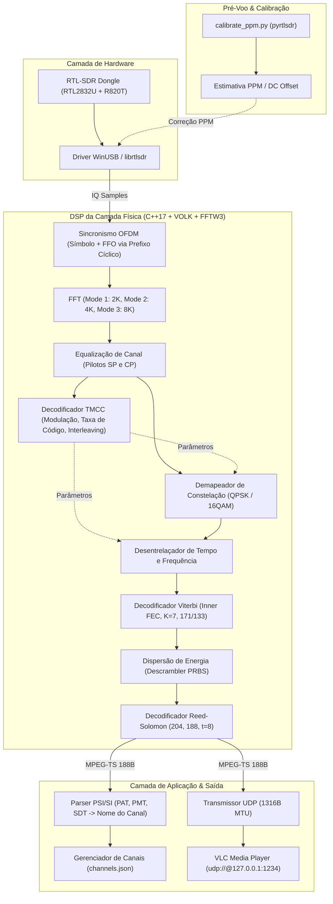

# 📡 Blueprint de Engenharia: Decodificador Universal ISDB-T / ISDB-Tb (1-Seg)

Este documento sintetiza todas as decisões técnicas acordadas durante a sessão de alinhamento (`/grill-me`), definindo a arquitetura, o pipeline DSP, o fluxo de dados e os marcos de implementação do decodificador universal em C++17 com suporte multiplataforma (Windows 10+ e Linux).

---

## 🎯 1. Decisões Arquiteturais Definidas

1. **Escopo de Rádio / Camada Física:**
   - **Foco estrito em 1-Seg (One-Seg móvel):** O RTL-SDR opera com estabilidade até ~2.4 MSps (largura útil ~2 MHz). O sinal 1-Seg ocupa o segmento central 0 (\(\approx 428.57\text{ kHz}\)), sendo 100% viável e confiável sem perdas de amostragem por saturação de barramento USB.
2. **Ambiente de Build e Compilação:**
   - **Windows:** MinGW-w64 (GCC 16.2 / G++ 16.2) + CMake via `w64devkit` (já verificado no sistema).
   - **Linux:** GCC/Clang + CMake nativo.
   - **Dependências Matemáticas:** VOLK + FFTW3 + `librtlsdr`, compiladas diretamente para o ambiente.
3. **Calibração e Pré-Voo:**
   - **Abordagem Híbrida:** Script Python auxiliar (`tools/calibrate_ppm.py` via `pyrtlsdr`) para estimativa de PPM/DC offset, integrado ao fluxo da CLI.
4. **Scanner de Frequências (Channel Scanner):**
   - **Varredura Sequencial Profunda:** Foco em máxima sensibilidade. Tenta travar sincronismo OFDM e decodificar tabelas PSI/SI (SDT/NIT) em cada canal da lista de frequências globais (UHF Brasil 14–51 / Japão 13–52).
5. **Streaming e Apresentação ao Usuário:**
   - **Streaming Nativo UDP para o VLC:** Encapsulamento padrão broadcast de 7 pacotes MPEG-TS (188 bytes) por datagrama UDP (\(7 \times 188 = 1316\text{ bytes}\)) enviado para `udp://@127.0.0.1:1234`.
   - Flag `--vlc` opcional para acionar o reprodutor VLC automaticamente com a URL do fluxo.
6. **Estratégia de Validação do DSP:**
   - **Validação Híbrida Guiada por Testes:** Gravação de amostras IQ reais usando o dongle já conectado, validação de cada bloco DSP por testes unitários e de integração (com flag `--file capture.raw`) e validação final ao vivo (`--device 0`).

---

## 🏗️ 2. Arquitetura do Sistema



---

## 📂 3. Estrutura Proposta do Repositório

```
isdb_t_isdb_tb_tuner_player/
├── CMakeLists.txt
├── README.md
├── scripts/
│   ├── install_deps_windows.ps1   # Compilação/download de librtlsdr, fftw3 e volk
│   └── calibrate_ppm.py           # Medição de PPM com pyrtlsdr
├── include/
│   ├── hardware/
│   │   ├── rtlsdr_device.hpp      # Descoberta, ganho/AGC, leitura assíncrona
│   │   └── iq_file_reader.hpp     # Leitor de arquivos IQ raw para testes
│   ├── dsp/
│   │   ├── ofdm_sync.hpp          # Correção de frequência fina e timing
│   │   ├── fft_processor.hpp      # Wrapper FFTW3 para os modos 2K/4K/8K
│   │   ├── channel_equalizer.hpp  # Interpolação de pilotos e equalização
│   │   ├── tmcc_decoder.hpp       # Frame sync e decodificação do bloco TMCC
│   │   ├── deinterleaver.hpp      # Desentrelaçamento em frequência e tempo
│   │   ├── viterbi_decoder.hpp    # Viterbi pontuado (soft/hard)
│   │   ├── descrambler.hpp        # Polinômio PRBS X^15 + X^14 + 1
│   │   └── reed_solomon.hpp       # RS(204, 188) outer FEC
│   ├── mpegts/
│   │   ├── ts_packet.hpp          # Validação do sync byte 0x47 e payload
│   │   └── psi_parser.hpp         # Extração de PAT, PMT, SDT (nome do canal)
│   ├── streaming/
│   │   └── udp_streamer.hpp       # Socket UDP 7x188 bytes para VLC
│   ├── cli/
│   │   ├── channel_manager.hpp    # Persistência em channels.json (cross-platform)
│   │   └── scanner.hpp            # Varredura profunda sequencial de frequências
│   └── utils/
│       ├── platform.hpp           # Stdout binário, ANSI terminal, signal handling
│       └── metrics.hpp            # Cálculo de SNR, RSSI e BER em tempo real
├── src/
│   ├── main.cpp                   # Ponto de entrada CLI (CLI11)
│   └── ... (implementações correspondentes)
└── tests/
    ├── test_reed_solomon.cpp      # Teste determinístico do RS(204, 188)
    ├── test_descrambler.cpp       # Teste do PRBS de dispersão de energia
    ├── test_viterbi.cpp           # Teste do decodificador Viterbi
    ├── test_tmcc.cpp              # Teste de decodificação de frame TMCC
    └── test_dsp_pipeline.cpp      # Teste ponta a ponta com captura IQ gravada
```

---

## 🚦 4. Roteiro de Implementação (Fases)

### **Fase 1: Preparação do Ambiente e Dependências**
- Instalação e verificação de `librtlsdr`, `fftw3` e `volk` com MinGW-w64.
- Criação do `CMakeLists.txt` inicial e teste de compilação de um "Hello RTL-SDR".
- Verificação da comunicação com o dongle físico já plugado (`VID_0BDA&PID_2838`).

### **Fase 2: Gravação de Amostras IQ & Testes Unitários de FEC**
- Gravação de uma amostra IQ de referência com o RTL-SDR em um canal 1-Seg ativo.
- Implementação e validação unitária dos blocos de menor nível:
  - Reed-Solomon (204, 188).
  - Descrambler de energia (`0xB8` / `0x47`).
  - Viterbi Decoder (taxas 1/2, 2/3, 3/4...).
  - Desentrelaçadores de tempo e frequência.

### **Fase 3: Core OFDM, Sincronismo e TMCC**
- Implementação da autocorrelação de prefixo cíclico (estimativa FFO e borda do símbolo).
- Processador FFT (FFTW3) configurado para Mode 3 (8K), Mode 2 (4K) e Mode 1 (2K).
- Equalizador com base nos pilotos contínuos e dispersos.
- Decodificador de sinalização TMCC (garantindo lock de frame).

### **Fase 4: Demux MPEG-TS, PSI/SI e Scanner**
- Validação e montagem de pacotes TS de 188 bytes.
- Extração de metadados da transmissão (tabela SDT para obter o nome da emissora).
- Scanner sequencial profundo testando a tabela de frequências UHF globais e salvando em `channels.json`.

### **Fase 5: Streaming UDP e Interface CLI**
- Transmissão UDP de 1316 bytes por datagrama para `127.0.0.1:1234`.
- Integração da flag `--vlc` para disparo do VLC.
- Subcomandos da CLI: `probe`, `scan`, `list` e `play`.
- Validação final ao vivo sintonizando canais da região.

